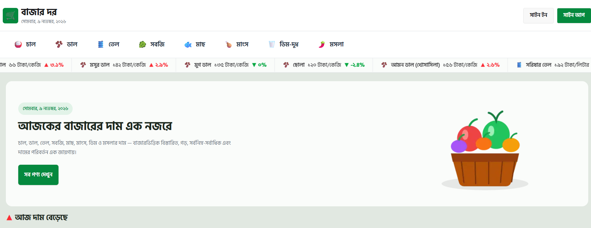

# 🌿 বাজার দর | BazarDor

<p align="center">
  <strong>Your Daily Market Price Companion 🇧🇩</strong>
</p>

<p align="center">
  A web application that helps people in Bangladesh explore daily market prices, compare prices across markets, and track price changes.
</p>

<p align="center">
  <a href="https://bazar-dor-hazel-two.vercel.app/">🌐 Live Website</a> |
  <a href="https://github.com/rasheduldev/bazar-dor">📂 GitHub Repository</a>
</p>

---

## 📖 About the Project

**BazarDor (বাজার দর)** is a web application designed to help people in Bangladesh stay informed about the daily prices of essential products.

Users can explore product prices, compare prices across different markets, and view minimum, maximum, and average prices to make better purchasing decisions.

The platform also provides user authentication and profile management features.

## 📸 Project Screenshot

<!-- Add your actual project screenshot here -->



## ✨ Key Features

- 📊 **Daily Market Prices:** Explore prices of essential products.
- 🛒 **Product Details:** View minimum, maximum, and average prices.
- 📍 **Market Comparison:** Compare product prices across different markets.
- 📈 **Price Changes:** Track price increases and decreases.
- 🔐 **User Authentication:** Sign in using supported social login providers.
- 👤 **Profile Management:** Manage your authenticated user profile.
- 📱 **Responsive Interface:** Enjoy a modern interface across different devices.

## 🛠️ Technologies Used

- Next.js
- React
- JavaScript
- Tailwind CSS
- DaisyUI
- Better Auth
- MongoDB
- React Icons
- React Hot Toast
- React Marquee Text

## 📦 Dependencies

### Main Dependencies

| Package | Purpose |
|---|---|
| next | React framework |
| react | User interface library |
| react-dom | React DOM rendering |
| better-auth | Authentication |
| @better-auth/mongo-adapter | MongoDB adapter for Better Auth |
| mongodb | MongoDB database driver |
| daisyui | UI component library |
| react-icons | Icons |
| react-hot-toast | Toast notifications |
| react-marquee-text | Marquee text component |

### Development Dependencies

| Package | Purpose |
|---|---|
| tailwindcss | Utility-first CSS framework |
| @tailwindcss/turbopack | Tailwind CSS integration |
| babel-plugin-react-compiler | React Compiler plugin |
| eslint | Code linting |
| eslint-config-next | Next.js ESLint configuration |

## 🚀 Installation and Setup

Follow these steps to run the project locally.

### Prerequisites

- Node.js
- npm
- Git
- MongoDB database (local or MongoDB Atlas)

### 1. Clone the Repository

```bash
git clone https://github.com/rasheduldev/bazar-dor.git
```

### 2. Navigate to the Project Folder

```bash
cd bazar-dor
```

### 3. Install Dependencies

```bash
npm install
```

### 4. Configure Environment Variables

Create a `.env.local` file in the root directory.

Add the environment variables required by the application.

These may include:

- MongoDB connection configuration
- Better Auth secret and URL
- Social authentication provider credentials

**Note:** Use the exact variable names from your project's configuration files. Never upload private credentials or secret keys to GitHub.

### 5. Run the Development Server

```bash
npm run dev
```

Open [http://localhost:3000](http://localhost:3000) in your browser.

### 6. Build for Production

```bash
npm run build
```

### 7. Run the Production Server

```bash
npm run start
```

### 8. Run ESLint

```bash
npm run lint
```

## 🔐 Authentication

BazarDor uses **Better Auth** for authentication and MongoDB for storing authentication data.

The application supports social authentication providers configured in the project.

To use authentication locally, configure the required authentication credentials and database connection.

## 🌐 Live Project

- **Live Website:** https://bazar-dor-hazel-two.vercel.app/
- **GitHub Repository:** https://github.com/rasheduldev/bazar-dor

## 👨‍💻 Author

**Rashedul Alam Rashed**

- GitHub: [@rasheduldev](https://github.com/rasheduldev)
- Email: [rashedulalam2k04@gmail.com](mailto:rashedulalam2k04@gmail.com)

---

<p align="center">
  Made with ❤️ in Bangladesh 🇧🇩
</p>
